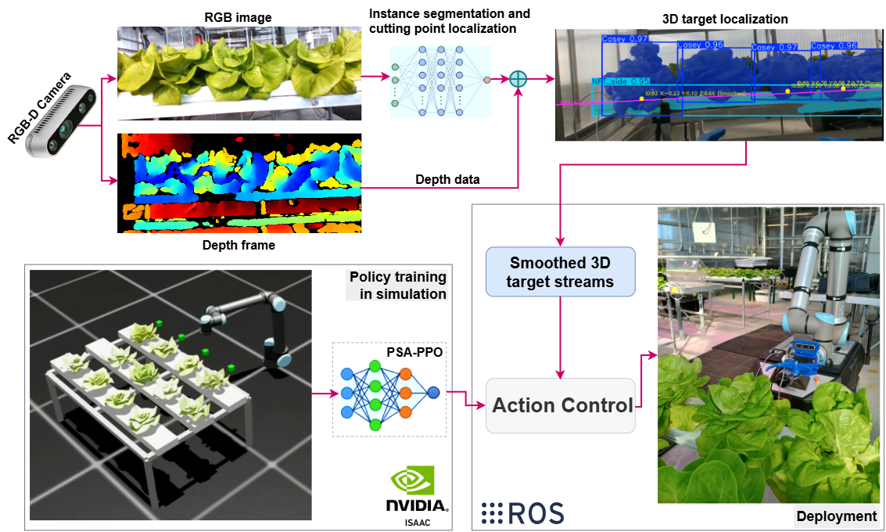

# Sim-to-Real Reinforcement Learning for Path-Safe Target Reaching in Robotic Harvesting of Hydroponic Lettuce

**[Paper (arXiv)](https://arxiv.org/abs/2610.22337)** · **[PDF](https://arxiv.org/pdf/2610.22337)**



*Figure 1. Overview of the sim-to-real PSA-PPO framework, connecting RGB-D target localization, simulation-trained policy control, and deployment on a physical UR10e robotic harvesting system.*

## Overview

This repository accompanies our study of **Path-Safe Approach Proximal Policy Optimization (PSA-PPO)** for target-conditioned robotic reaching in constrained harvesting environments. PSA-PPO formulates the local reaching task around target acquisition and harvesting-compatible approach trajectories. The policy is trained in NVIDIA Isaac Lab and evaluated on a physical UR10e manipulator within a vision-guided hydroponic lettuce harvesting system.

## Resources

- **Preprint:** [arXiv:2610.22337](https://arxiv.org/abs/2610.22337) (available)
- **Source code and configurations:** Coming soon
- **Trained policies and supporting resources:** To be announced

## Citation

If you use or refer to this work, please cite the preprint:

```bibtex
@misc{bashir2026psappo,
  title         = {Sim-to-Real Reinforcement Learning for Path-Safe Target Reaching in Robotic Harvesting of Hydroponic Lettuce},
  author        = {Bashir, Al and Ghose, Partho and Wang, Yibin and Hardin, Robert G. and Peeples, Joshua and Niu, Genhua and Zahid, Azlan},
  year          = {2026},
  eprint        = {2610.22337},
  archivePrefix = {arXiv},
  primaryClass  = {cs.RO},
  doi           = {10.48550/arXiv.2610.22337},
  url           = {https://arxiv.org/abs/2610.22337}
}
```

*The journal publication citation will be added when available.*
